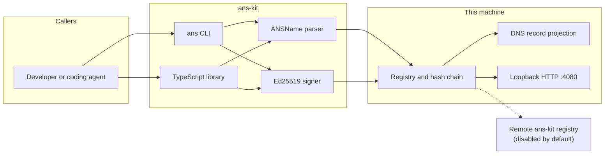
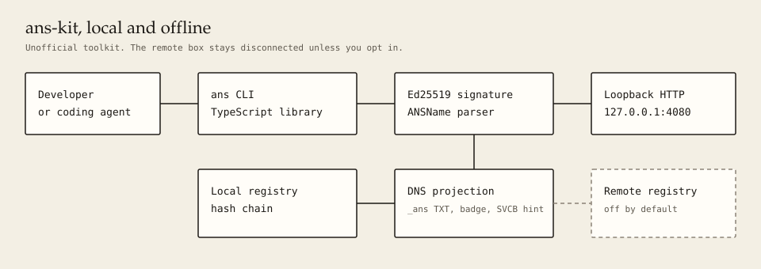
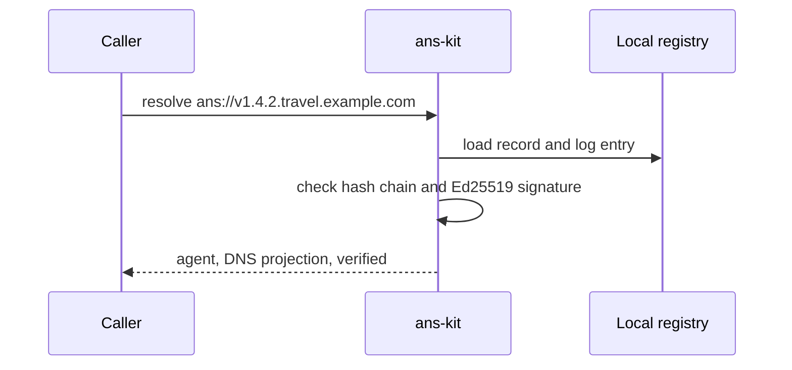

# ans-kit

Agents are about to need a name the rest of the internet can check. On 10 November 2026 the Linux Foundation announced at KubeCon that the Agent Name Service is now a foundation project — DNS-backed identity, registration, and authentication for AI agents, with Cisco, Salesforce, Cloudflare, and others among the supporters (widely reported on 12 November).

**ans-kit** is an unofficial, independent toolkit for that model on your laptop: versioned `ans://` names, a local registry, and Ed25519 signatures. No API key. No network, unless you turn a remote on. It is not a Linux Foundation, Cisco, Salesforce, or Cloudflare project, and it does not speak for the ANS specification.

<p>
  <a href="https://github.com/tz0127302-cell/ans-kit/actions/workflows/ci.yml"></a>
  
  
  
  
</p>

Source: [github.com/tz0127302-cell/ans-kit](https://github.com/tz0127302-cell/ans-kit).

## Install

Clone this repository (Node.js 20+). Do **not** run `npm install ans-kit` against the public npm registry: as of November 2026 that name is an unrelated DNS-record compiler. This package is also named `ans-kit` so the local CLI and library match the commands below, and you install it from this GitHub source.

```bash
git clone https://github.com/tz0127302-cell/ans-kit.git
cd ans-kit
npm install
npx ans --help
```

The package binary is `ans`. After `npm install` in this checkout, `npx ans-kit` runs the same command. Both are linked into `node_modules/.bin`.

To depend on the library from another project, install the GitHub source rather than the colliding npm package:

```bash
npm install github:tz0127302-cell/ans-kit
```

The package is ESM-only. `prepare` builds `dist/` from TypeScript when you install from source.

## Quickstart

About a minute, fully offline, from the clone above.

```bash
npm install
npx ans init --demo
npx ans resolve ans://v1.4.2.travel.example.com
npx ans auth verify --name ans://v1.4.2.travel.example.com
```

`init --demo` writes three signed sample agents and throws away nothing of yours: the keys are generated on this machine under `.ans/keys/`.

Register one of your own:

```bash
npx ans auth keygen --out .ans/keys/dispatch
npx ans register \
  --name ans://v1.0.0.dispatch.example.com \
  --display-name "Dispatch" \
  --description "Routes work between travel and billing agents." \
  --protocol a2a \
  --endpoint https://dispatch.example.com/a2a \
  --key .ans/keys/dispatch.private.pem
npx ans auth issue \
  --name ans://v1.0.0.dispatch.example.com \
  --key .ans/keys/dispatch.private.pem \
  --audience billing.example.com \
  --out .ans/dispatch-assertion.json
npx ans auth verify \
  --assertion .ans/dispatch-assertion.json \
  --audience billing.example.com
```

Add `.ans/` to `.gitignore`. It holds local keys and the registry.

Peek at the DNS projection:

```bash
npx ans resolve ans://v1.4.2.travel.example.com --zone
```

Or open the loopback status page:

```bash
npx ans serve
```

Then visit [http://127.0.0.1:4080](http://127.0.0.1:4080). Ctrl+C stops it.

`--json` prints one JSON object on stdout for `register`, `resolve`, `list`, `auth`, and errors. Exit codes: `0` ok, `1` usage or input, `2` not found, `3` verification failed, `4` already exists.

## What you get

| Piece | What it does |
| --- | --- |
| `ans init` | Creates `.ans/` with the remote client off. `--demo` loads sample agents. |
| `ans register` | Signs a registration with your Ed25519 key and appends it to the local log. |
| `ans resolve` | Loads the name, checks the hash chain and the signature, prints a DNS projection. |
| `ans list` | Lists local agents. |
| `ans auth` | `keygen`, `issue`, and `verify`. Assertions last 5 minutes unless you set `--ttl`. |
| `ans serve` | Loopback HTTP registry plus a small status page. |
| `ans-kit` library | The same operations from TypeScript. |

## Architecture







## Naming

Public ANS-2 (draft 0.3.0, 2026-11-03) writes a name as:

```text
ans://v{major}.{minor}.{patch}.{agentHost}
```

```text
ans://v1.4.2.travel.example.com
         │       └─ agentHost, an LDH FQDN (travel.example.com)
         └─ semantic version, numeric only, prefixed with v in the URI
```

| Piece | Rule | Example |
| --- | --- | --- |
| Scheme | Always lowercase `ans` | `ans://` |
| Version | `major.minor.patch`, no `-beta`, no leading zeros | `v1.4.2` |
| agentHost | Two or more LDH labels, 1–63 characters each, host ≤ 253 | `travel.example.com` |
| Display name | Metadata, max 64 characters, not part of the identifier | `Travel Concierge` |
| Description | Optional, max 150 characters | `Plans trips within a company travel policy.` |

Versions of one host coexist. `ans://v1.0.0.dispatch.example.com` and `ans://v1.1.0.dispatch.example.com` are different registrations. A version cannot be reused.

`agent.example.ans` is a valid host only as a normal FQDN (`ans://v1.0.0.agent.example.ans`). The `.ans` label is not special. The scheme is `ans://`.

International names use punycode (`xn--`). Unicode labels are rejected, matching the LDH rule in ANS-2.

`_ans-badge.{host}` has to fit in a DNS name, so a host that is legal under the 253-character cap can still be rejected when the badge label would overflow. Details and the signed-document format are in [docs/protocol.md](docs/protocol.md).

## Authentication

`ans auth keygen` writes an Ed25519 PKCS#8 private key (mode `0600`), an SPKI public key, and a JWK:

```text
{ "kty": "OKP", "crv": "Ed25519", "x": "..." }
```

`ans register` signs a canonical JSON document that includes that public key. `ans resolve` verifies the signature before it returns the record. `ans auth issue` signs a short-lived assertion (audience, nonce, expiry). `ans auth verify` checks the assertion and, by default, that the key matches the local registration.

This is the ans-kit profile `ans-kit-ed25519-v0`. The public ANS-6 design authenticates agents with X.509 Identity Certificates (a URI SAN holding the ANSName and a DNS SAN holding the host) over mTLS, with DPoP as another caller method. Use the Ed25519 profile to build and test locally. Do not describe those assertions as ANS Identity Certificates.

The local hash chain is also a developer stand-in. ANS-4 seals events into a transparency log with SCITT receipts. ans-kit hashes each registration into an append-only chain so a quiet edit to `registry.json` fails verification. It does not produce a SCITT receipt.

## Library

```ts
import { readFileSync } from "node:fs";
import { LocalRegistry, issueAssertion, verifyAssertion } from "ans-kit";

const registry = await LocalRegistry.open(".ans/registry.json");
const resolved = await registry.resolve("ans://v1.4.2.travel.example.com");
console.log(resolved.record.document.agentDisplayName, resolved.verified);

const assertion = issueAssertion({
  ansName: "ans://v1.4.2.travel.example.com",
  privateKeyPem: readFileSync(".ans/keys/travel.private.pem", "utf8"),
  audience: "billing.example.com",
  ttlSeconds: 300,
});
const check = verifyAssertion(assertion, {
  audience: "billing.example.com",
  registryRecord: resolved.record,
});
console.log(check.ansName, check.expiresAt);
```

`registry.resolve` checks the signature and can fall back to a remote ans-kit server. `resolveName(registry, name, options)` is the same function, and it is what the CLI and the HTTP server call.

```ts
import { resolveName, buildDnsRecordSet, parseAnsName, generateKeyPair } from "ans-kit";
```

## Local server

```bash
npx ans serve --host 127.0.0.1 --port 4080
curl -s http://127.0.0.1:4080/v0/resolve?name=ans://v1.4.2.travel.example.com
```

| Method | Path |
| --- | --- |
| GET | `/` status page, `/health`, `/v0/agents`, `/v0/log` |
| GET | `/v0/resolve?name=`, `/v0/dns?name=`, `/v0/badges/:ansName` |
| POST | `/v0/agents` with `{ "document", "signature" }` |
| POST | `/v0/auth/verify` with `{ "assertion", "audience"? }` |

The server never sees a private key. Bind stays on loopback unless you pass `--host`. There is no HTTP password.

## Remote registry

Fully offline is the default. `.ans/config.json` ships with:

```json
{ "version": 1, "registryPath": "registry.json", "publicRegistry": { "enabled": false, "url": null } }
```

To ask another **ans-kit** server when a name is missing locally:

```bash
npx ans resolve ans://v1.0.0.dispatch.example.com --public-registry http://127.0.0.1:4080
```

or export `ANS_PUBLIC_REGISTRY_URL`. A local hit never leaves the machine. `--offline` forces the local file even if the variable is set. The client checks the Ed25519 signature itself, refuses redirects, and times out after 5 seconds. That URL is not a Linux Foundation root; none is wired in.

## How this tracks the public spec

| Public description | ans-kit 0.1 |
| --- | --- |
| ANS-2 name `ans://v1.4.2.travel.example.com` | Parsed and enforced |
| Display name ≤ 64, description ≤ 150 | Enforced |
| `_ans` TXT `v=ans1; version=v…; p=…; mode=…; url=…` | Emitted |
| `_ans-badge` TXT `v=ans-badge1; version=v…; url=…` | Emitted, with a local badge URL |
| DNS-AID SVCB at the host | Illustrative `alpn` row only |
| Proof of domain control, private CA, Identity Certificate | Not implemented |
| SCITT transparency log, DANE/TLSA | Not implemented |
| mTLS and DPoP (ANS-6) | Ed25519 assertion profile instead |

Primary sources: the [Linux Foundation announcement](https://www.linuxfoundation.org/press/linux-foundation-welcomes-agent-name-service-to-bring-verifiable-identity-and-discovery-to-ai-agents) (10 November 2026), the public [ans-spec](https://github.com/agentnameservice/ans-spec) drafts, and [ansinfo.ai](https://ansinfo.ai/). If the technical steering committee revises the ANSName grammar after ANS-2 0.3.0, the parser in `src/name.ts` needs to follow. This repo will not pretend a local file is that committee's registry.

## Development

```bash
npm install
npm test
npm run lint
npm run typecheck
npm run smoke
```

`npm test` builds `dist/` and runs Vitest. `npm run smoke` executes the quickstart against the built binary. [CI](https://github.com/tz0127302-cell/ans-kit/actions/workflows/ci.yml) runs lint, typecheck, tests, and smoke on Node 20 and 22.

See [CONTRIBUTING.md](CONTRIBUTING.md), [docs/protocol.md](docs/protocol.md), and [SECURITY.md](SECURITY.md).

## Roadmap

- Follow ANS-2 if the published name grammar changes.
- Optional DNS-over-HTTPS check that a projection is actually published.
- SCITT receipts in place of the local hash chain.
- A private-CA Identity Certificate profile (URI SAN + DNS SAN) beside the Ed25519 keys.
- A domain-control challenge before a name is accepted.
- TLSA projection when a server certificate is supplied.
- mTLS and DPoP helpers aligned with ANS-6.
- A remote root, still opt-in, if an open public endpoint exists.

## 中文简介

ans-kit 是一个非官方的 Agent Name Service 开发工具包。2026 年 11 月，Linux Foundation 在 KubeCon 上接纳了 ANS，用 DNS 给 AI agent 提供可验证的名字、注册和身份核验。这个仓库让你在本机离线试用这套模型：`ans://` 名字、本地注册表、Ed25519 签名，不需要 API key。它与 Linux Foundation、Cisco、Salesforce、Cloudflare 没有隶属关系，也不是 ANS 规范本身。

```bash
git clone https://github.com/tz0127302-cell/ans-kit.git
cd ans-kit
npm install
npx ans init --demo
npx ans resolve ans://v1.4.2.travel.example.com
```

## License

[MIT](LICENSE). Copyright 2026 ans-kit contributors.
